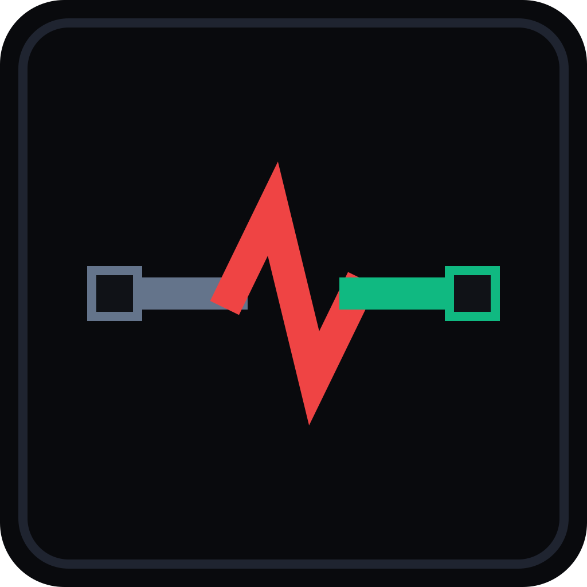

<p align="center">
  
</p>

<h1 align="center">z-proxy</h1>

<p align="center">
  Fault injection, concurrency bursts and payload fuzzing for HTTP services on your own machine.
</p>

---

z-proxy sits between a client and a service on `localhost`, breaks the traffic on purpose and
shows what the service does about it. It is a desktop app: Tauri v2 shell, Rust engine on
Tokio, React UI laid out like a packet capture tool.

Every socket the engine opens is restricted to `127.0.0.1`, `::1` and `localhost`. Any other
target is rejected before a connection is made.

## What it does

- **Reverse proxy with faults.** Latency jitter, TCP resets, status rewrites and truncated
  bodies, globally or per route, from a seedable decision engine.
- **Concurrency bursts.** N requests released on a shared barrier to expose race windows,
  duplicate writes and divergent responses, with connect / TTFB / total timing per request.
- **Payload fuzzer.** Deterministic boundary, type and schema mutations of a request body,
  with stack trace, database error and field leak detection. Every case is replayable.
- **Route scanner.** Extracts routes from Next.js, Express, Fastify, Hono, axum and Go
  (net/http, gin, echo, chi) projects or an OpenAPI document, and flags risky handlers before
  anything is sent.
- **Passive audit.** Watches proxied traffic for N+1 fan-outs, retry storms, unpaginated
  collections and header misconfiguration.
- **Target lab.** A built-in loopback service with switchable defects, for trying everything
  above without a project of your own.
- **Audit report.** Markdown or JSON export of every finding.

## Download

Windows installers are attached to each
[release](https://github.com/s7codes/z-proxy/releases/latest). Requires the WebView2 runtime,
which ships with Windows 10 and 11.

## Build from source

Node.js 20.19+, Rust 1.90+. On Linux, the WebKitGTK 4.1 development packages.

```
npm install
npm run tauri dev       # run
npm run tauri build     # installer in src-tauri/target/release/bundle
```

Checks run by CI on Linux and Windows:

```
npm run build
cd src-tauri && cargo fmt --check && cargo clippy --all-targets -- -D warnings && cargo test
```

## License

MIT. See [LICENSE](LICENSE).
